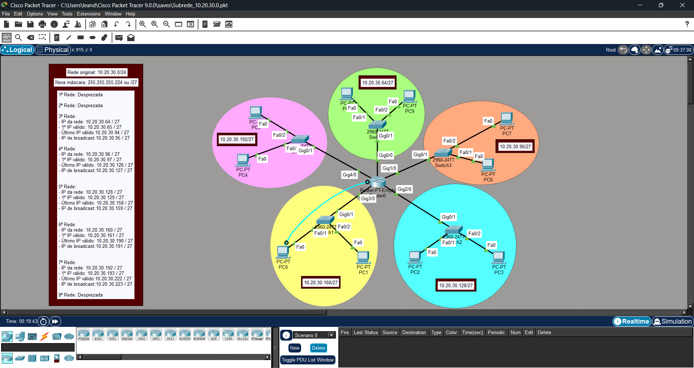

Planejamento e Implementação de Sub-redes IPv4

Sobre o projeto

Projeto prático desenvolvido no Cisco Packet Tracer 9.0, com o objetivo de dividir uma rede IPv4 "/24" em cinco sub-redes "/27", configurar o endereçamento IP dos dispositivos e validar a comunicação entre diferentes redes por meio de testes de conectividade.

Objetivos

- Aplicar conceitos de subnetting IPv4.
- Calcular endereços de rede, hosts e broadcast.
- Configurar endereços IP e gateways padrão.
- Configurar interfaces de um roteador.
- Validar a comunicação entre diferentes sub-redes.

Tecnologias e conceitos utilizados

- Cisco Packet Tracer 9.0
- IPv4
- Subnetting
- Endereçamento IP
- Roteamento entre redes
- ICMP (Ping)

Topologia da rede

A topologia foi composta por:

- 1 roteador central
- 5 switches
- 10 computadores
- 5 sub-redes IPv4

Planejamento de endereçamento

Rede original: "10.20.30.0/24"

Máscara de sub-rede: "255.255.255.224 (/27)"

Sub-rede| Endereço de rede| Gateway| Broadcast
1| 10.20.30.64/27| 10.20.30.65| 10.20.30.95
2| 10.20.30.96/27| 10.20.30.97| 10.20.30.127
3| 10.20.30.128/27| 10.20.30.129| 10.20.30.159
4| 10.20.30.160/27| 10.20.30.161| 10.20.30.191
5| 10.20.30.192/27| 10.20.30.193| 10.20.30.223

Configuração do roteador

Foram configuradas cinco interfaces GigabitEthernet no roteador, cada uma associada ao gateway de uma das sub-redes.

Após a configuração, todas as interfaces apresentaram estado operacional "up/up".

O roteamento entre as redes foi realizado por meio das redes diretamente conectadas ao roteador.

Testes de conectividade

Foram realizados cinco testes de ping entre computadores pertencentes a sub-redes diferentes. Cada teste foi executado duas vezes.

Teste| Origem| Destino| 1ª execução| 2ª execução
1 — PC8| 10.20.30.66| 10.20.30.131| 25% de perda| 0% de perda
2 — PC4| 10.20.30.194| 10.20.30.99| 25% de perda| 0% de perda
3 — PC7| 10.20.30.98| 10.20.30.163| 25% de perda| 0% de perda
4 — PC3| 10.20.30.130| 10.20.30.195| 25% de perda| 0% de perda
5 — PC0| 10.20.30.163| 10.20.30.66| 0% de perda| 0% de perda

Resultado: os cinco testes confirmaram a comunicação entre as sub-redes. Nas quatro primeiras execuções houve perda de um pacote; nas respectivas segundas execuções, todos os pacotes foram recebidos com sucesso. O quinto teste apresentou 0% de perda nas duas execuções.

Arquivo do projeto

"Subrede_10.20.30.0.pkt"

Competências desenvolvidas

- Planejamento de redes IPv4.
- Cálculo e divisão de sub-redes (Subnetting).
- Configuração de endereçamento IP.
- Configuração de interfaces de roteadores.
- Roteamento entre redes diretamente conectadas.
- Testes e validação de conectividade.

---

Ferramenta: Cisco Packet Tracer 9.0
Categoria: Redes de Computadores
Tipo: Projeto prático acadêmico
